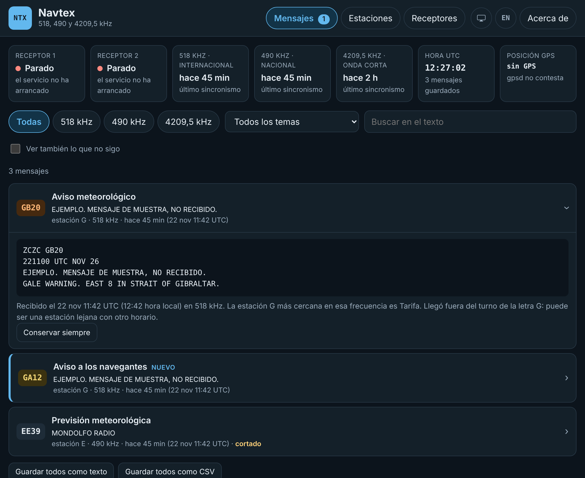
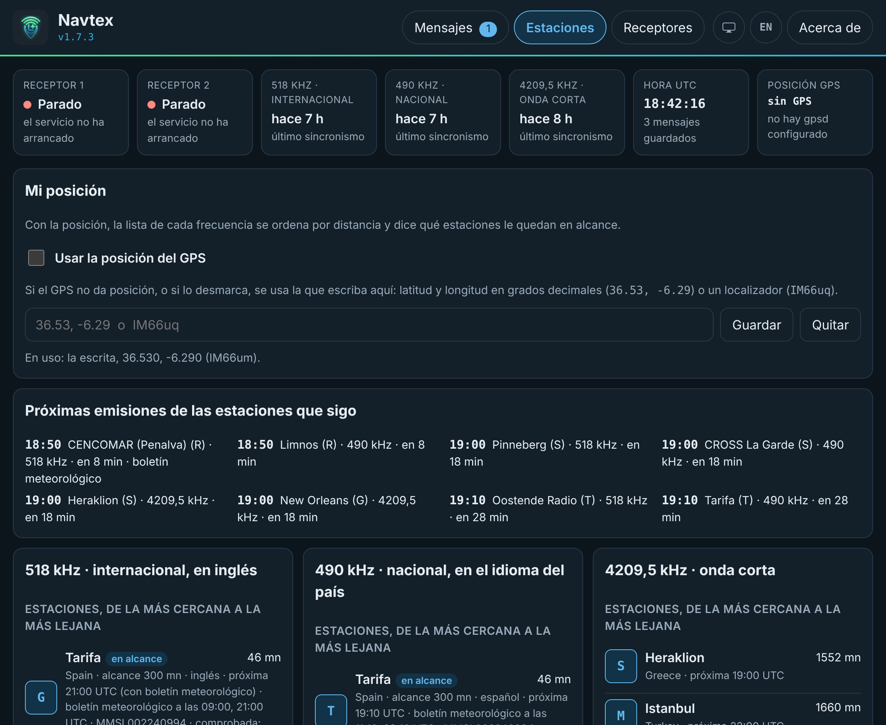
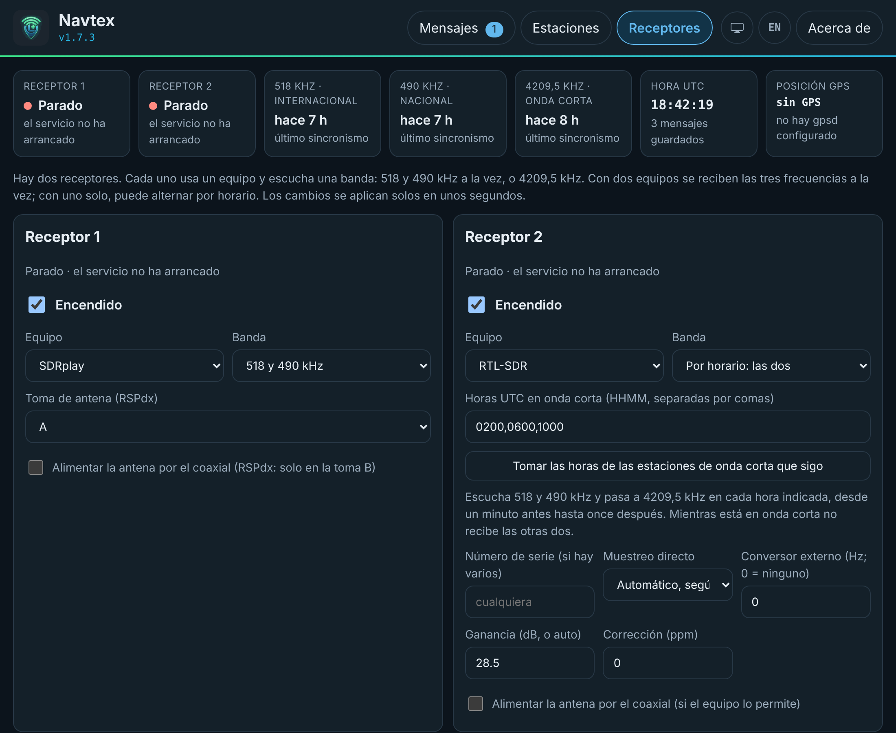
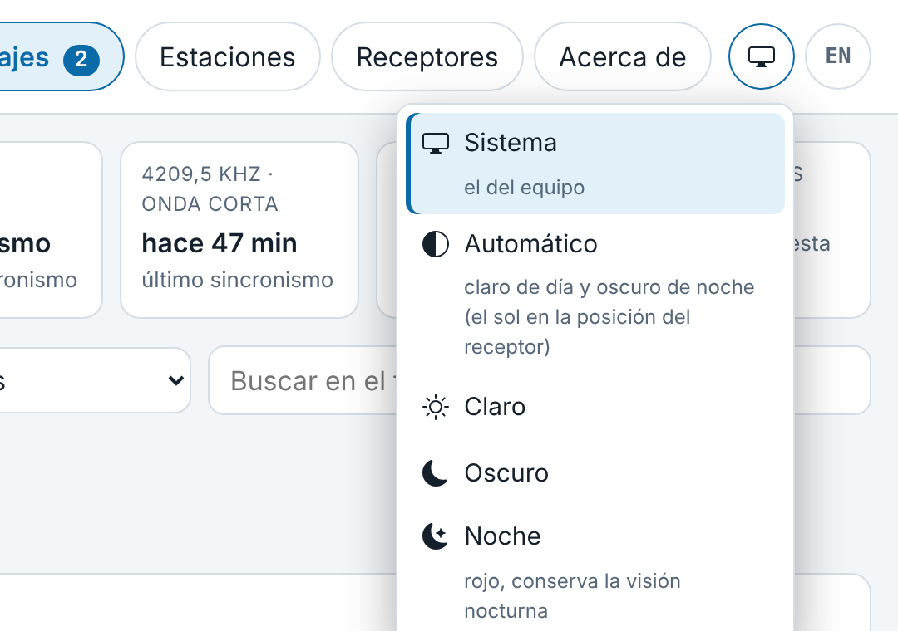
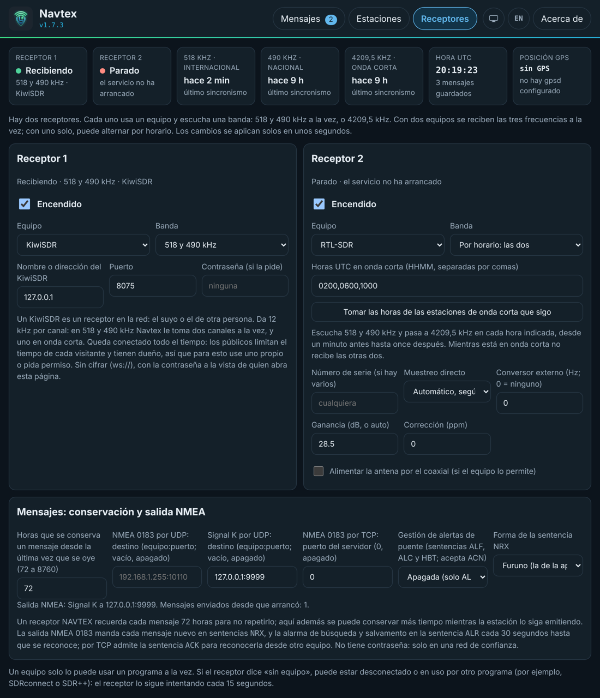

# Navtex

Receptor NAVTEX por software para Linux, con SDRplay, RTL-SDR o un KiwiSDR de la red. Escucha en segundo plano 518 y 490 kHz a la vez, o 4209,5 kHz en onda corta, guarda los mensajes y los enseña en una interfaz web en español que funciona sin Internet.

Navtex · © 2026 Manuel - EA7JRS · fork de [bartelvdh/Navtex](https://github.com/bartelvdh/Navtex) · GPL-3.0-or-later · parte del ecosistema APRS LoRa+

[](https://paypal.me/ea7jrs)



*Las capturas son de un equipo de pruebas sin receptor conectado. Los mensajes GA12 y GB20 son de muestra y lo dicen en su texto; el EE39 está descodificado de una grabación real.*

> **Aviso.** Este programa es una ayuda. No sustituye a un receptor NAVTEX homologado donde este sea obligatorio, ni a las publicaciones oficiales.

📘 [Normas y reglamentos que contempla](docs/NORMAS.md) · 📝 [Historial de cambios](CHANGELOG.md)

## Qué hace

| Función | Detalle |
| :--- | :--- |
| Recepción en segundo plano | Los mensajes se guardan aunque nadie esté mirando; cada estación emite cada cuatro horas, en su turno de diez minutos |
| Tres frecuencias | 518 kHz (internacional) y 490 kHz (nacional) a la vez con un receptor; 4209,5 kHz (onda corta) con el mismo receptor por horario, o con un segundo receptor a la vez |
| Tres tipos de receptor | SDRplay (RSP1A, RSP1B, RSP2, RSPdx, RSPdx-R2), RTL-SDR (muestreo directo, conversor integrado o externo) y [KiwiSDR](#kiwisdr) por la red, sin equipo propio |
| Dos receptores a la vez | Cada uno con su equipo y su banda, ajustados desde la web y sin reiniciar nada |
| Interfaz web | En español o en inglés, adaptada al móvil y sin cargar nada de Internet. Aspecto del sistema, automático por la salida y la puesta del sol, claro, oscuro o de noche (rojo) |
| Estaciones del mundo | 263 estaciones con letra, posición, horas, alcance e idioma; ordenadas por distancia desde la posición propia |
| Posición por GPS | Tomada de gpsd; recuadro con la posición junto a la hora |
| Salida para otros programas | API en JSON; [S.A.T.-APRS+](https://github.com/EA7JRS/sat-aprs) la usa para convertir los mensajes en avisos y para manejar el receptor desde su consola |
| Mensajes incompletos o con errores | Se guardan marcados, con su número de caracteres mal recibidos; una copia mejor sustituye a una peor, nunca al revés |
| Reglas de un receptor NAVTEX | Recepción buena con menos de un 4 % de errores; cada mensaje se recuerda 72 horas para no repetirlo; los de número 00 se muestran siempre; se comprueba el turno de la letra |
| Conservar y guardar | Los mensajes no se pueden borrar a mano (MSC.508(105), 6.1.1): salen solos al cumplir su tiempo; marcar mensajes para conservarlos siempre; guardar todos en un archivo de texto o CSV; tiempo de conservación ajustable |
| Alarma de búsqueda y salvamento | Un mensaje del tema D da una alarma, en pantalla y sonora, que solo se apaga a mano |
| Salida NMEA 0183 | Cada mensaje nuevo en sentencias `NRX` (forma de Furuno o de la norma IEC 61097-6) y la alarma en `ALR` (y, si se enciende, con las sentencias de gestión de alertas del puente `ALF`, `ALC` y `HBT`), por UDP y por un servidor TCP. Por TCP admite `ACK` o `ACN` para apagar la alarma y `NRM` para ver y cambiar desde otro equipo las estaciones y temas que se siguen |
| Signal K, OpenPlotter y OpenCPN | Cada mensaje y la alarma de búsqueda y salvamento, como «deltas» de [Signal K](#signal-k-openplotter-y-opencpn) por UDP; OpenCPN recibe las sentencias NMEA |

## Estado de las pruebas

Probado el 22-11-2026 en un Intel NUC con Debian 13:

- la instalación y los servicios;
- un SDRplay RSPdx-R2 y un Nooelec NESDR SMArt v5 abiertos y recibiendo muestras a la vez;
- la posición por gpsd, con un Leo Bodnar LBE-1420;
- la interfaz web desde otros equipos de la red;
- el descodificador, con dos grabaciones reales de NAVTEX.

Probado el mismo día fuera del NUC, con el programa real y esas grabaciones: las reglas del receptor, la exportación, la salida NMEA 0183 por UDP y TCP (sentencias `NRX`, `ALR`, `ACK`, `NRM` y las de gestión de alertas del puente `ALF`, `ALC`, `HBT`, `ACN` y `ARC`) y la alarma de búsqueda y salvamento, esta con un mensaje escrito para la prueba y nunca emitido. `make check` repite 124 comprobaciones.

Probado el 23-11-2026, versión 1.8.0: instalada y en marcha en ese NUC; el **KiwiSDR**, contra uno de pega que emite una grabación real de NAVTEX (el mensaje se descodifica y se guarda); y la salida a **Signal K**, viendo salir los «deltas» por UDP.

**Sin probar todavía:** la recepción de un mensaje completo del aire, una emisión real en 4209,5 kHz, un KiwiSDR de verdad, la salida NMEA 0183 con un plotter, la salida a un servidor Signal K o a OpenCPN y la gestión de alertas con un equipo de puente real. El detalle de cada parte está en el [historial de cambios](CHANGELOG.md).

## Vista previa

| Mensajes | Estaciones |
| :---: | :---: |
| [](docs/img/mensajes.png) | [](docs/img/estaciones.png) |
| Lista por frecuencia y tema, con el texto, la calidad de la recepción y «Conservar siempre» | Las 263 estaciones por distancia, con su próxima emisión y qué se sigue |
| **Receptores** | **Aspecto** |
| [](docs/img/receptores.png) | [](docs/img/aspecto.png) |
| Equipo (SDRplay, RTL-SDR o KiwiSDR) y banda de cada receptor, conservación, salida NMEA 0183 y Signal K | Sistema, automático por el sol, claro, oscuro o noche; español o inglés |

Cada apartado de la interfaz se explica en [La interfaz web](#la-interfaz-web).

## Qué hace falta

- Un equipo con Linux. Está hecho y probado en Debian 13; un procesador modesto basta.
- Un receptor:
  - **SDRplay**, con su API 3.15 o posterior instalada ([sdrplay.com/api](https://www.sdrplay.com/api/)); o
  - **RTL-SDR** que llegue a onda media: por muestreo directo (Nooelec NESDR SMArt v5, RTL-SDR Blog V3), con conversor integrado (RTL-SDR Blog V4) o con conversor externo; o
  - un **KiwiSDR** de la red, el suyo o uno con permiso de su dueño: no hace falta ningún equipo enchufado ni ninguna librería (véase [KiwiSDR](#kiwisdr)).
- Una antena para 490–518 kHz (con un KiwiSDR, la antena es la suya). Las antenas activas de NAVTEX necesitan alimentación; véase [Antenas](#antenas).
- Opcional: un GPS servido por gpsd, para la posición propia.

### Dependencias y librerías

| Paquete de Debian | Para qué | ¿Obligatorio? |
| :--- | :--- | :--- |
| `git` | Descargar el código y actualizarlo | Sí |
| `build-essential` | Compiladores de C y C++ (`gcc`, `g++`) y `make` | Sí |
| `autoconf`, `automake` | Generan `configure` y los `Makefile` | Sí |
| `libcjson-dev` | cJSON: el JSON de la API y de los ajustes | Sí |
| `libsqlite3-dev` | SQLite: la base de datos de mensajes y ajustes | Sí |
| `libmicrohttpd-dev` | GNU libmicrohttpd: el servidor de la interfaz web | Sí |
| `sqlite3` | Crea la base de datos al instalar | Sí |
| `librtlsdr-dev` | Receptores RTL-SDR | Solo con RTL-SDR |
| API de SDRplay 3.15 o posterior | Receptores SDRplay. No está en Debian: se baja de [sdrplay.com/api](https://www.sdrplay.com/api/) y se instala con su propio instalador | Solo con SDRplay |
| `gpsd` | Posición propia | Opcional |

`./configure` comprueba cada librería y dice al final qué receptores quedan incluidos. Para un equipo enchufado hace falta al menos uno de los dos (RTL-SDR o SDRplay); sin ninguno, el programa compila igual y recibe con un KiwiSDR o descodifica grabaciones. Las licencias de cada librería están en [COPYING.md](COPYING.md).

## Instalación

**1. Dependencias.** Si va a usar un SDRplay, instale antes su API.

```bash
sudo apt install git build-essential autoconf automake libcjson-dev libsqlite3-dev libmicrohttpd-dev sqlite3 librtlsdr-dev
```

**2. Descargar el código.**

```bash
git clone https://github.com/EA7JRS/Navtex.git
cd Navtex
```

**3. Compilar.**

```bash
autoreconf -i && automake --add-missing; autoreconf
./configure
make
```

`./configure` acaba con una línea como `receivers: SDRplay yes, RTL-SDR yes`: compruebe que el suyo dice `yes`.

**4. Comprobar (opcional).** Pasa las pruebas de las reglas del receptor, la memoria y las sentencias NMEA; no toca la instalación.

```bash
make check
```

**5. Instalar los programas.** Van a `/usr/local/bin`; la interfaz web y la base de datos, a `/opt/Navtex`.

```bash
sudo make install
```

**6. Montar los servicios.** Toma como usuario el que ejecuta `sudo`, o el que se indique con `--usuario`.

```bash
sudo sh tools/instalar-servicios.sh
```

**7. Abrir la interfaz:** `http://<equipo>:8080/`. Elija equipo y banda de cada receptor en la pestaña Receptores. Si hay cortafuegos, abra ese puerto a la red local (y, si usa la salida NMEA 0183 por TCP, también el puerto que elija para ella):

```bash
sudo ufw allow from 192.168.0.0/16 to any port 8080 proto tcp
```

### Actualizar

Desde la carpeta donde se clonó el código (no desde `/opt/Navtex`, que es donde se instala), con el usuario dueño de esa carpeta:

```bash
git pull
autoreconf -i && automake --add-missing; autoreconf
./configure && make
sudo make install
sudo systemctl restart navtex-web navtex-receiver@1 navtex-receiver@2
```

La base de datos con los mensajes y los ajustes se conserva (`Keeping the existing /opt/Navtex/Navtex.db`). Después, recargue la página con Ctrl+F5: la versión instalada se lee bajo el nombre, en la cabecera, y en `curl -s http://127.0.0.1:8080/api/status`.

La carpeta del código puede estar donde quiera (por ejemplo `/opt/navtex-src`), pero no es `/opt/Navtex`: esa es la de los datos, y **no se borra** (guarda `Navtex.db` y la interfaz instalada).

### Desinstalar

```bash
sudo sh tools/instalar-servicios.sh --quitar     # para y retira los servicios
sudo make uninstall                              # quita los programas de /usr/local/bin
```

`/opt/Navtex` (mensajes y ajustes) y `/etc/default/navtex` no se borran: quítelos a mano si ya no los quiere.

## Servicios

| Servicio | Qué hace |
| :--- | :--- |
| `navtex-web` | La interfaz web y la API, en el puerto 8080 |
| `navtex-receiver@1` | Receptor 1 |
| `navtex-receiver@2` | Receptor 2: siempre en marcha, pero no toca ningún equipo hasta que se enciende en la web |

Ninguno se ejecuta como `root`. El puerto, la dirección de escucha y el gpsd de la interfaz web están en `/etc/default/navtex`.

**Receptor compartido.** Un equipo solo lo puede usar un programa a la vez. Si en el sistema hay servicios `sdrconnect` o `sdrpp-server`, el instalador declara el receptor 1 incompatible con ellos: arrancar uno para el otro, y el receptor 1 no arranca solo.

```bash
sudo systemctl start navtex-receiver@1   # recibir NAVTEX con el SDRplay
sudo systemctl start sdrconnect          # devolvérselo a SDRconnect
```

Registro en vivo: `journalctl -u 'navtex-receiver@*' -f`

## Comandos

### Servicios

| Comando | Qué hace |
| :--- | :--- |
| `systemctl is-active navtex-web navtex-receiver@1 navtex-receiver@2` | Dice si los tres están en marcha |
| `systemctl status navtex-web` | Estado y últimas líneas de la interfaz web |
| `sudo systemctl restart navtex-web` | Reinicia la interfaz web (tras cambiar `/etc/default/navtex` o actualizar) |
| `sudo systemctl restart navtex-receiver@1` | Reinicia el receptor 1 (`@2` para el segundo) |
| `sudo systemctl stop navtex-receiver@1` | Suelta el equipo, por ejemplo para usarlo con otro programa |
| `journalctl -u 'navtex-receiver@*' -f` | Registro en vivo de los receptores: sincronismo y mensajes guardados |
| `journalctl -u navtex-web -n 50` | Últimas 50 líneas de la interfaz web y de la salida NMEA |
| `sudo sh tools/instalar-servicios.sh --usuario <nombre>` | Vuelve a montar los servicios con otro usuario |
| `sudo sh tools/instalar-servicios.sh --quitar` | Para y retira los servicios |

### `navtexreceiver`: el receptor

Los servicios lo arrancan con `-n 1` y `-n 2`. A mano sirve para probar un equipo o descodificar una grabación (pare antes el servicio que use ese equipo).

| Opción | Qué hace |
| :--- | :--- |
| `-h` | Ayuda con todas las opciones |
| `-n 1` o `-n 2` | Receptor 1 o 2: toma todos los ajustes de la web y sigue sus cambios sin reiniciar |
| `-s sdrplay` \| `rtlsdr` \| `kiwi` \| `file` | Tipo de equipo (de serie, SDRplay si está compilado; si no, RTL-SDR) |
| `-K <equipo[:puerto]>` | Un KiwiSDR de la red como receptor (puerto 8073) |
| `-W <contraseña>` | Su contraseña, si la pide |
| `-B mf` \| `hf` | Banda: 518 y 490 kHz a la vez (de serie), o solo 4209,5 kHz |
| `-b` | Alimenta la antena por el coaxial (bias T) |
| `-p A` \| `B` \| `C` | SDRplay: toma de antena (RSPdx, RSPdx-R2) |
| `-i <n>` | RTL-SDR: número de equipo (de serie, 0) |
| `-S <serie>` | RTL-SDR: elige el equipo por su número de serie |
| `-D 0` \| `1` \| `2` | RTL-SDR: muestreo directo apagado, rama I o rama Q. Sin indicarlo, según el modelo |
| `-u <hercios>` | RTL-SDR: oscilador de un conversor externo, por ejemplo `125000000` |
| `-g <dB>` | RTL-SDR: ganancia, por ejemplo `28.0` (de serie, automática; no se usa en muestreo directo) |
| `-P <ppm>` | RTL-SDR: corrección del cristal |
| `-f <archivo>` | Descodifica una grabación en vez de un receptor: `.wav` de 16 bits con I y Q (como las de `-d`) o I/Q de 8 bits sin signo (como las de `rtl_sdr`), a 252000 muestras/s centradas en 504 kHz |
| `-t` | Con `-f`: reproduce la grabación a velocidad real |
| `-d` | Graba además las muestras recibidas en un `.wav` |
| `-v` / `-q` | Muestra cada carácter recibido / solo lo importante |

Ejemplos:

```bash
navtexreceiver -s rtlsdr                 # RTL-SDR, modo según el modelo, 518 y 490 kHz
navtexreceiver -p C                      # SDRplay por la toma C
navtexreceiver -s rtlsdr -u 125000000    # RTL-SDR con conversor de 125 MHz
navtexreceiver -B hf                     # 4209,5 kHz
navtexreceiver -f grabacion.wav          # descodificar una grabación
```

### `navtexwebserver`: la interfaz web y la API

```bash
navtexwebserver [puerto] [dirección]
```

| Argumento | Qué es |
| :--- | :--- |
| `puerto` | Puerto TCP (de serie, 8080) |
| `dirección` | Dirección IPv4 en la que escucha (de serie, todas); `127.0.0.1` para solo este equipo |

Como servicio toma el puerto, la dirección y el gpsd de `/etc/default/navtex` (`WEB_PORT`, `WEB_ADDRESS`, `NAVTEX_GPSD`); tras cambiarlos, `sudo systemctl restart navtex-web`.

### Compilación

| Comando | Qué hace |
| :--- | :--- |
| `autoreconf -i && automake --add-missing; autoreconf` | Genera `configure` (tras clonar o actualizar) |
| `./configure` | Comprueba las librerías y prepara la compilación |
| `make` | Compila `navtexreceiver` y `navtexwebserver` |
| `make check` | Pasa las pruebas (124 comprobaciones) |
| `sudo make install` | Instala los programas y la interfaz; conserva la base de datos |
| `sudo make uninstall` | Quita los programas |
| `make clean` | Borra lo compilado |

### Consultas rápidas

```bash
curl -s http://127.0.0.1:8080/api/status                  # estado: receptores, mensajes, alarmas
curl -s "http://127.0.0.1:8080/api/messages?since=0"      # todos los mensajes, en JSON
curl -s -o navtex.txt "http://127.0.0.1:8080/api/export?format=txt"   # guardarlos en un archivo
curl -s http://127.0.0.1:8080/api/nrx                     # estado de la salida NMEA 0183
curl -s -X POST -H "X-Navtex: 1" http://127.0.0.1:8080/api/alarm/ack  # reconocer la alarma de salvamento
```

Todas las llamadas están en [API](#api). La salida NMEA 0183 por TCP se puede mirar con `nc <equipo> <puerto>`.

### Dónde está cada cosa

| Ruta | Qué hay |
| :--- | :--- |
| `/usr/local/bin/navtexreceiver`, `/usr/local/bin/navtexwebserver` | Los dos programas |
| `/opt/Navtex/Navtex.db` | Mensajes y ajustes (SQLite) |
| `/opt/Navtex/build/` | La interfaz web |
| `/etc/default/navtex` | Puerto, dirección de escucha y gpsd de la interfaz web |
| `/etc/systemd/system/navtex-web.service`, `navtex-receiver@.service` | Los servicios |

## La interfaz web

La cabecera es la de la WebUI de APRS LoRa+: el logotipo, el nombre con la versión debajo y la raya de color. Tiene las tres pestañas (Mensajes, Estaciones y Receptores) y, a la derecha, el botón de aspecto, el de idioma y «Acerca de», con la versión, las normas que sigue y los créditos.

**Idioma.** Español o inglés. De serie, el del navegador; el botón `EN` / `ES` lo cambia y se recuerda en ese navegador. Los mensajes se muestran siempre tal como se reciben.

**Aspecto.** Su botón abre el mismo menú que la WebUI del tracker APRS LoRa+:


| Modo | Qué hace |
| :--- | :--- |
| Sistema | El del equipo (de serie) |
| Automático | Claro de día y oscuro de noche, por la salida y la puesta del sol en la posición del receptor; sin posición, claro de 8 a 20 h |
| Claro, Oscuro | Fijos |
| Noche | Rojo sobre negro, para no perder la visión nocturna |

### Mensajes

Lista con el tema en claro, la primera línea del texto, la estación, la frecuencia y hace cuánto llegó. El color indica la importancia: salvamento, aviso meteorológico, aviso a los navegantes. Hay marcas de «nuevo», «conservado», «cortado» y «con errores», filtros por frecuencia y por tema, y búsqueda en el texto. Un asterisco en el texto es un carácter que no se pudo recibir bien.

Al abrir un mensaje se ve el texto entero y, debajo, cuándo se recibió, si la estación lo sigue emitiendo, qué estación lo mandó (por su letra y su hora), cuántos caracteres llegaron mal y si llegó fuera de su turno. Un botón: **Conservar siempre** (o **Dejar de conservar**). No hay botón de borrar: los mensajes salen solos al cumplir su tiempo (véase [Reglas de un receptor NAVTEX](#reglas-de-un-receptor-navtex)). Debajo de la lista: **Guardar todos como texto** y **Guardar todos como CSV**.

Un mensaje de búsqueda y salvamento (tema D) pone arriba un aviso rojo, con pitido, hasta que se pulsa **Reconocer la alarma**.

### Estaciones


- **Mi posición:** la del GPS si lo hay; si no, la que se escriba (latitud y longitud en grados decimales, o un localizador).
- **Por frecuencia:** las estaciones de la más cercana a la más lejana, con su letra, alcance, idioma y próxima emisión, y cuáles quedan en alcance. Se siguen con un toque, o todas las que están en alcance de una vez.
- **Próximas emisiones** de las estaciones que se siguen.
- **Temas:** los temas A, B, D y L (avisos a los navegantes, avisos meteorológicos y salvamento) no se pueden quitar, como en un receptor homologado.

En la cabecera de cada mensaje, `ZCZC GA12`, la primera letra es la estación y la segunda el tema. Seguir una letra muestra los mensajes de todas las estaciones que la usan.

### Receptores


Para cada uno de los dos receptores: encendido, equipo (SDRplay, RTL-SDR o KiwiSDR), banda y los ajustes del equipo. El receptor aplica los cambios en unos segundos. Debajo, **Mensajes: conservación y salida NMEA**: las horas que se conserva un mensaje, el destino UDP, el puerto del servidor TCP, la forma de la sentencia `NRX` y el destino de **Signal K por UDP**.

| Banda | Qué escucha |
| :--- | :--- |
| 518 y 490 kHz | Las dos a la vez |
| 4209,5 kHz | Solo onda corta |
| Por horario | 518 y 490 kHz, y pasa a 4209,5 kHz en las horas UTC indicadas, desde un minuto antes hasta once después |

Un receptor escucha una banda o la otra: 518 y 490 kHz van juntas porque están a 28 kHz, pero 4209,5 kHz queda a 3,7 MHz. Para las tres a la vez hacen falta dos equipos.

## Receptores

### SDRplay

Vale con RSP1A, RSP1B, RSP2, RSPdx y RSPdx-R2. En el RSPdx y el RSPdx-R2 se elige la toma de antena (A, B o C); la alimentación por el coaxial solo existe en la toma B.

### RTL-SDR

Un RTL-SDR no sintoniza por sí solo estas frecuencias. Hay tres formas de llegar, y el programa elige según el modelo que anuncia el equipo:

| Equipo | Modo |
| :--- | :--- |
| Nooelec NESDR SMArt v5 | Muestreo directo, rama Q (de 0,1 a 25 MHz, sin cambiar nada) |
| RTL-SDR Blog V3 y otros con muestreo directo | Rama Q; la rama I se elige a mano |
| RTL-SDR Blog V4 | Apagado: usa su conversor integrado |
| Con conversor externo | Apagado; se indica la frecuencia del conversor |

Con 8 bits y sin filtros de entrada, un RTL-SDR recibe NAVTEX peor que un SDRplay: en onda media las emisoras de radiodifusión cercanas lo saturan con facilidad. Una antena de NAVTEX, que solo deja pasar su banda, lo resuelve en buena parte.

### KiwiSDR

Un receptor de la red en lugar de uno enchufado: véase [KiwiSDR](#kiwisdr).

### Antenas

Las antenas activas de NAVTEX necesitan alimentación, y no siempre vale la que da el receptor:

| Antena | Dato publicado |
| :--- | :--- |
| JRC NAW-333 | 518, 490 y 4209,5 kHz; 6,5 V y 23 mA; 50 Ω (manual del JRC NCR-333) |
| NASA Marine H Vector | Activa, alimentada por el coaxial; el fabricante no publica la tensión |

La alimentación por el coaxial de un RSPdx ronda los 4,7 V, y el Nooelec NESDR SMArt v5 no tiene. Para una antena que pida otra tensión hace falta un inyector externo con la tensión correcta. **No alimente una antena a una tensión superior a la indicada por su fabricante.**

### A mano, sin servicios

```bash
navtexreceiver -h                              # todas las opciones
navtexreceiver -p C                            # SDRplay, toma C, 518 y 490 kHz
navtexreceiver -s rtlsdr                       # RTL-SDR, modo según el modelo
navtexreceiver -s rtlsdr -u 125000000          # RTL-SDR con conversor de 125 MHz
navtexreceiver -B hf                           # 4209,5 kHz
navtexreceiver -f grabacion.wav                # descodificar una grabación
navtexreceiver -n 1                            # receptor 1, con los ajustes de la web
```

En una terminal muestra cada carácter recibido; como servicio, solo lo importante (`-v` y `-q` lo fuerzan). Con `-d` graba además las muestras en un `.wav`, que luego se puede volver a descodificar con `-f`.

## Posición por GPS

La interfaz web lee la posición de gpsd: de serie, el del propio equipo (`127.0.0.1:2947`). Se cambia o se quita con `NAVTEX_GPSD` en `/etc/default/navtex`. El servidor solo lee; no envía nada al GPS.

**Leo Bodnar LBE-1420.** Su puerto serie es a la vez salida NMEA y consola de órdenes: en cuanto recibe un carácter deja de emitir, hasta que se le envía `nmea`. gpsd sondea los puertos al arrancar y lo deja callado. Se evita arrancando gpsd en solo lectura, con `GPSD_OPTIONS="-n -b"` en `/etc/default/gpsd`. Si ya se ha callado:

```bash
sudo systemctl stop gpsd gpsd.socket
printf 'nmea\r' | sudo tee /dev/ttyACM0 > /dev/null
sudo systemctl start gpsd.socket gpsd
```

## Estaciones del mundo

`web_server/build/estaciones.json` trae 263 estaciones: 170 en 518 kHz, 87 en 490 kHz y 6 en 4209,5 kHz.

| Fuente | Qué aporta |
| :--- | :--- |
| UIT, «Coast stations participating in the NAVTEX services» (Tabla 4; coordinada con la OMI, GMDSS.1/Circ.21, 31-05-2017) | 518 y 490 kHz |
| Wikipedia, «List of Navtex stations» (CC BY-SA 4.0), consultada el 22-11-2026 | 4209,5 kHz, que la tabla de la UIT no trae |
| Instituto Hidrográfico de la Marina, «Radioseñales», edición de 2023 | Comprobación de 52 emisiones de las NAVAREA II y III (España, Portugal, Francia, Mediterráneo y mar Negro): estado, alcance, en qué turnos va el boletín meteorológico y MMSI del centro |

Los datos de origen están en `tools/estaciones/`, y `python3 tools/estaciones/generar.py` los comprueba y genera el archivo. En NAVTEX la letra fija la hora de emisión; de las 257 estaciones de la UIT, 254 cumplen esa regla, y las otras tres se listan al generar.

**Onda corta (4209,5 kHz).** Si [Wefax](https://github.com/EA7JRS/Wefax) está en el mismo equipo con VOACAP instalado, cada estación de 4209,5 kHz dice además qué parte de los días del mes llega su señal a la hora de la próxima emisión (predicción de VOACAP, mediana del mes, con 5 kW supuestos). En 518 y 490 kHz no hay predicción: ahí cuenta el alcance en millas.

**Comprobación con Radioseñales 2023.** De esa publicación solo se toman datos sueltos, cotejados uno a uno (`tools/estaciones/ihm_2023.csv`); es © IHM y no se copia. Donde difiere de la UIT manda ella, por ser más reciente, y la nota de la estación lo dice: Cross Corsen (518 y 490 kHz) figura inactiva, y cambian los alcances de Split, Kosseir, Piombino, las estaciones griegas, turcas y ucranianas. Las estaciones comprobadas dicen a qué horas emiten el boletín meteorológico (Tarifa: 09:00 y 21:00 UTC en 518 kHz; 11:10 y 23:10 en 490 kHz). Las horas de los boletines se sacaron de sus tablas con un programa y se revisaron a ojo las españolas; no se pudieron sacar las de Grecia, La Garde en 518 kHz, Kosseir ni Novorossiysk.

**Los datos de 518 y 490 kHz de la UIT son de 2017 y los del IHM de 2023: pueden haber cambiado.** Sirven para orientarse; compruébelos con las publicaciones oficiales en vigor.

## API

Para que otro programa recoja los mensajes por la red. Todo en JSON y con las horas en UTC.

| Dirección | Qué devuelve |
| :--- | :--- |
| `GET /api/messages?since=<id>&limit=<n>` | Los mensajes con identificador mayor que `since`, del más antiguo al más reciente, con el texto completo. Sin filtros y sin marcar nada como leído. `limit` de 1 a 500 (200 si no se indica) |
| `GET /api/status` | Versión, estado de cada receptor (`rx1.state`, `rx1.source`, `rx1.band`…), última vez que llegaron muestras, último sincronismo en cada frecuencia, número de mensajes y último identificador |
| `GET /api/gps` | Posición, fijo, satélites y hora del GPS |
| `GET /api/settings` | Ajustes de los receptores y de la posición |

| `GET /api/messages?since=<id>&heard=<hora unix>` | Además, los mensajes que se han vuelto a oír después de `heard`: los que la estación sigue emitiendo |
| `GET /api/export?format=txt` o `csv`, y `&freq=518`, `490` o `4209` | Todos los mensajes en un archivo |
| `GET /api/nrx` | Estado de la salida NMEA 0183 |
| `POST /api/alarm/ack` | Reconoce la alarma de búsqueda y salvamento |
| `POST /api/messages/keep/<id>/1` o `/0` | Marca un mensaje para conservarlo siempre, o quita la marca |

```json
{"id":5,"bbbb":"EE39","station":"E","subject":"E","number":39,"freq":490,
 "received":"2026-11-22T07:38:00Z","complete":false,"characters":765,"errors":3,
 "satisfactory":false,"heard":1795333080,"in_slot":false,"unread":true,
 "message":"ZCZC EE39\n062040 UTC NOV 21\n..."}
```

`freq` vale 518, 490 o 4209 (por 4209,5 kHz). `errors` son los caracteres que no se pudieron recibir (los asteriscos); `satisfactory`, que el mensaje llegó entero y con menos de un 4 % de errores; `heard`, la última vez que se oyó; `in_slot`, si llegó en el turno de su letra. El uso previsto es preguntar cada minuto con el último `id` recibido.

Un mensaje del tema D sin reconocer lleva además `"alarm":true`, y `/api/status` dice cuántos hay en `sar_alarms`.

Los cambios (`/api/settings/<clave>/<valor>`, `/saveconfig/<ajuste>/<valor>`, `/api/messages/keep/…` y `/api/alarm/ack`) solo se aceptan por `POST` y con la cabecera `X-Navtex`, de modo que otra página abierta en el mismo navegador no puede cambiar nada.

## Reglas de un receptor NAVTEX

El detalle, norma por norma y apartado por apartado, con lo que se aplica y lo que no, está en **[docs/NORMAS.md](docs/NORMAS.md)**.

El programa sigue lo que piden a un receptor la resolución MSC.508(105) de la OMI (la vigente, para equipos instalados desde 2024; antes, la MSC.148(77)) y el Manual NAVTEX en su edición de 2023, y las características de la Recomendación UIT-R M.540 (impresión directa de banda estrecha con corrección de errores, modo B colectivo: 100 baudios y 170 Hz de desplazamiento).

| Regla | Cómo se aplica |
| :--- | :--- |
| Un mensaje se da por bien recibido con menos de un 4 % de caracteres erróneos (MSC.508(105), 6.2.3) | Se cuentan los caracteres que no se pudieron recibir. Solo un mensaje completo y por debajo del 4 % impide que se guarde su repetición |
| La identidad de un mensaje (B1B2B3B4) se recuerda de 60 a 72 horas (MSC.508(105), 6.2.2) | 72 horas. En ese tiempo, la repetición no vuelve a aparecer como nueva; después, sí |
| Un mensaje mal recibido no se recuerda | Si la estación lo repite mejor, la copia nueva sustituye a la anterior |
| Los mensajes con B3B4 = 00 se muestran siempre (UIT-R M.540, Manual NAVTEX 5.4.3) | Se guardan cada vez, y la interfaz los enseña aunque no se siga esa estación o ese tema |
| Los temas A, B, D y L no se pueden rechazar (Manual NAVTEX 5.3.4) | En la interfaz no se pueden desmarcar |
| El carácter mal recibido se marca con un asterisco (MSC.508(105), 5.7) | Así se guarda y así se muestra |
| Cada letra B1 tiene diez minutos cada cuatro horas: A a las 0000, B a las 0010… X a las 0350 (Manual NAVTEX, tabla 2) | Cada mensaje dice si llegó en el turno de su letra, y con la hora se averigua cuál de las estaciones que comparten letra lo emitió |
| Memoria para al menos 200 mensajes (MSC.508(105), 6.1.1) | Sin límite de número; se borran al cumplir el tiempo de conservación sin volver a oírse |
| Una interfaz para pasar los datos a otros equipos, según IEC 61162 (MSC.508(105), 9) | Sentencias `NRX` de NMEA 0183 |

| La información de búsqueda y salvamento (B2 = D) da una alarma que solo se puede apagar a mano (MSC.508(105), 7; IEC 61097-6, 4.3.9) | Aviso rojo arriba de la interfaz, con pitido, hasta que se pulsa «Reconocer la alarma». El mensaje se muestra aunque no se siga esa estación. La repetición del mismo mensaje no la vuelve a disparar |
| La alarma se comunica con la sentencia `ALR`, cada 30 segundos hasta que se reconoce, y se puede reconocer con `ACK` (IEC 61097-6, 4.3.9.2, 4.3.9.3 y 8.4.2) | Por la salida NMEA 0183: alarma número 003 |

El pitido depende del navegador: la mayoría no deja sonar una página hasta que se ha tocado alguna vez, y no llega a los 75–85 dBA que pide la norma para un equipo de puente. Este programa no está homologado ni sustituye a un receptor que lo esté.

**Conservar.** Un mensaje marcado con «Conservar siempre» no se borra al cumplir el tiempo de conservación, ni lo sustituye otro posterior con el mismo número. Hasta 50 (MSC.508(105), 6.1.2).

**Borrar.** El usuario no puede borrar mensajes de la memoria (MSC.508(105), 6.1.1): no hay botón ni llamada de la API para ello (`/api/messages/delete/…` contesta 410). Un mensaje sale solo, al cumplir su tiempo de conservación sin volver a oírse. Hasta la versión 1.6.1 se podían ocultar; al actualizar, los que estuvieran ocultos vuelven a verse.

**Conservación.** De serie, un mensaje se borra a las 72 horas de la última vez que se oyó. Se puede alargar hasta un año (pestaña Receptores). Mientras la estación lo siga emitiendo, no se borra.

## KiwiSDR

Un [KiwiSDR](http://kiwisdr.com) es un receptor de 0 a 30 MHz que se usa por la red; puede ser el suyo o el de otra persona. En **Receptores**, en *Equipo*, elija *KiwiSDR* y escriba su nombre o dirección, el puerto (8073) y la contraseña si la pide.

- **Dos canales en onda media.** Un KiwiSDR da 12 kHz por canal y 518 y 490 kHz están a 28 kHz: Navtex le toma dos canales a la vez, uno en cada frecuencia. En 4209,5 kHz, uno. Un KiwiSDR tiene 4 u 8 canales en total.
- **Queda conectado.** NAVTEX se escucha todo el día. Los KiwiSDR públicos limitan el tiempo de cada visitante, a veces no admiten dos conexiones desde la misma dirección, y tienen dueño: para esto use uno propio o pida permiso. Si está lleno o corta, Navtex lo dice en su registro y vuelve a probar al minuto.
- **La posición es la del KiwiSDR.** El alcance de las estaciones debe mirarse desde donde está el receptor: la página dice la posición que declara, para escribirla en *Estaciones > Mi posición*.
- **Sin cifrar.** La conexión es `ws://` y la contraseña se guarda como un ajuste más, a la vista de quien abra la página.

El protocolo es el del cliente de referencia, [kiwiclient](https://github.com/jks-prv/kiwiclient), leído de su código; no se copia nada de él. **Probado** contra un KiwiSDR de pega que emite una grabación real de NAVTEX (Mondolfo, 518 kHz): el mensaje se descodifica y se guarda. **Sin probar con un KiwiSDR de verdad.**



## Salida NMEA 0183

Cada mensaje nuevo sale en sentencias `NRX`, en una de dos formas:

**Furuno** (de serie; la que usan la app y el plotter APRS LoRa+):

```
$CRNRX,GA05,1,12,518,22,11,2026,090700,0.0,TEXTO DE LA PRIMERA LINEA*hh
```

Identidad, número de línea, total de líneas, frecuencia (518, 490 o 4209), día, mes, año, hora UTC de recepción, porcentaje de errores y texto. Una línea de texto por sentencia; las largas se parten, en un espacio si se puede.

**IEC 61097-6** (anexo C; la de la norma):

```
$CRNRX,003,001,00,GA05,2,090700,22,11,2026,85,0,A,PRINCIPIO DEL TEXTO*hh
$CRNRX,003,002,00,,,,,,,,,,SIGUE EL TEXTO^0D^0AOTRA LINEA*hh
```

Total de sentencias, número de sentencia, número de mensaje (00–99), identidad, frecuencia (1 = 490 kHz, 2 = 518 kHz, 3 = 4209,5 kHz), hora UTC, día, mes, año, total de caracteres, caracteres mal recibidos, estado (`A` si el mensaje llegó hasta su NNNN, `V` si no) y texto. El texto va seguido de una sentencia a la siguiente, con los finales de línea como `^0D^0A`; en las sentencias siguientes los demás campos van vacíos.

En las dos, ninguna sentencia pasa de 82 caracteres y los caracteres reservados van como `^hh`.

**Estaciones y temas desde otro equipo.** Por el servidor TCP se admite la sentencia `NRM` de la norma (IEC 61097-6, anexo C.2) y su consulta:

| Se recibe | Qué hace |
| :--- | :--- |
| `$--CRQ,NRM*hh` | Contesta con una `NRM` por frecuencia: qué estaciones y temas se siguen |
| `$--NRM,1,f,estaciones,temas*hh` | Cambia las estaciones y los temas que se siguen en esa frecuencia. Los temas A, B, D y L no se pueden quitar |
| `$--NRM,0,f,estaciones,temas*hh` | Manda los mensajes guardados de esa frecuencia que encajan, en sentencias `NRX`. No cambia nada |

`f` es 1 para 490 kHz, 2 para 518 kHz y 3 para 4209,5 kHz. Estaciones y temas son ocho cifras hexadecimales; el bit menos significativo es la letra A. Las funciones 2 y 3 de la norma (lo que sale por la impresora y por el puerto de datos) no existen aquí.

**Alarma.** Mientras haya un mensaje de búsqueda y salvamento sin reconocer, sale cada 30 segundos `$CRALR,hhmmss.00,003,A,V,NAVTEX: Search and rescue information*hh`; al reconocerla, una vez más con `V,A`. Por el servidor TCP se puede reconocer con `$--ACK,003*hh`.

**Gestión de alertas del puente** (ajuste `nrx.bam`, apagado de serie). Además de `ALR`, la misma alerta sale con las sentencias que usa la gestión de alertas del puente (MSC.302(87), IEC 62923):

```
$CRALF,1,1,0,122537.00,B,W,V,,3,1,2,0,NAVTEX SAR*5B     en cada cambio: V sin reconocer, N normal
$CRALC,01,01,00,1,,3,1,2*5E                             cada 30 s: lista de alertas activas
$CRHBT,30,A,1*10                                        cada 30 s: latido
```

Por TCP acepta `$--ACN,hhmmss.ss,,3,1,A,C*hh` (reconocer) y `…,Q,C` (repetir la alerta); silenciar (S) y transferir (O) no existen aquí y se contestan con `ARC`. Los formatos están tomados de manuales de equipos que las usan, no de las normas; el identificador (3), la categoría (B) y la prioridad (aviso) de la alerta están sin confirmar.

Se ajusta en la pestaña Receptores:

- **UDP**: destino `equipo:puerto` (vale la dirección de difusión de la red, por ejemplo `192.168.1.255:10110`). Una sentencia por datagrama.
- **TCP**: puerto de un servidor al que se conectan los programas (hasta 8 a la vez).

Solo salen los mensajes que llegan desde que se enciende la salida, no los ya guardados. La salida no tiene contraseña; de quien se conecta por TCP solo se atienden las sentencias `ACK`, `ACN`, `NRM` y `CRQ`. Con ellas se puede apagar la alarma y cambiar qué estaciones y temas se siguen, igual que desde la interfaz web: úsela solo en una red de confianza.

### Signal K, OpenPlotter y OpenCPN

| Programa | Cómo llegan los mensajes | Qué hace con ellos |
| :--- | :--- | :--- |
| **Signal K** (también el de OpenPlotter) | *Signal K por UDP*: escriba `equipo:puerto` del servidor. En el servidor: *Server > Data Connections > Add*, tipo de datos **Signal K**, origen **UDP**, y ese puerto | Cada mensaje queda en `communication.navtex.<frecuencia>.<identidad>` y la alarma de búsqueda y salvamento sale como aviso en `notifications.navtex.sar` |
| **OpenCPN** (también el de OpenPlotter) | *NMEA 0183 por UDP* hacia su equipo, o una conexión de red de OpenCPN, TCP, al puerto del servidor de Navtex | Recibe las sentencias `NRX` y `ALR` (se ven en su ventana de depuración de NMEA). Hasta donde sé, OpenCPN no enseña los mensajes NAVTEX por sí mismo |
| **OpenPlotter** | Es una Raspberry con Signal K y OpenCPN: valen las dos filas de arriba | Los avisos de Signal K los enseñan sus propias aplicaciones |

Lo que se manda a Signal K es un «delta» por mensaje, una línea de JSON por datagrama:

```json
{"updates":[{"source":{"label":"navtex","type":"NAVTEX"},"timestamp":"2026-11-22T09:07:00Z",
 "values":[{"path":"communication.navtex.518.GA05",
  "value":{"id":"GA05","station":"G","subject":"A","frequency":518000,
           "received":"2026-11-22T09:07:00Z","complete":true,"text":"ZCZC GA05\n..."}}]}]}
```

- **La ruta de los mensajes no es de la norma.** Signal K no tiene una ruta para NAVTEX: `communication.navtex…` es propia de este programa. Los avisos (`notifications.…`, con `state` `alarm` mientras la alarma espera y `normal` al reconocerla) sí siguen la especificación, así que cualquier programa que enseñe avisos de Signal K, como el plotter APRS LoRa+, la muestra.
- **Solo va hacia Signal K.** La alarma no se reconoce desde Signal K: se reconoce en la página o por la sentencia `ACK`.
- **Sin probar contra un servidor Signal K ni contra OpenCPN.** Está comprobado que los deltas salen por UDP con la forma de arriba; que el servidor los acepte tal cual está por ver.

**NMEA 2000.** No existe un mensaje normalizado de NMEA 2000 para el texto de NAVTEX; la salida normalizada es la sentencia `NRX` de NMEA 0183. Este programa no inventa uno: al bus llegan a través de S.A.T.-APRS+, que los recoge por la API.

## Seguridad

La interfaz no tiene contraseña: está pensada para la red local o la de a bordo. No la exponga a Internet.

- El servidor web y los receptores no se ejecutan como `root`; el servidor web va además encerrado en su carpeta.
- Solo se sirven los archivos de la interfaz; no se puede pedir ninguno de fuera.
- Los ajustes solo admiten claves y valores conocidos, y las consultas a la base de datos no se construyen con texto recibido.
- Lo recibido por radio se muestra siempre como texto, y el navegador tiene prohibido cargar nada que no sea de la propia interfaz.
- Con `navtexwebserver 8080 127.0.0.1` (o `WEB_ADDRESS=127.0.0.1`) escucha solo en el propio equipo.

## Solución de problemas

| Síntoma | Causa probable | Qué hacer |
| :--- | :--- | :--- |
| Receptor «Sin equipo» | Desconectado, o en uso por otro programa | `lsusb`; pare el otro programa. El receptor lo reintenta cada 15 s |
| El RTL-SDR no aparece en `lsusb` | Puerto o cable; con `error -71` en `dmesg`, mal contacto o falta de alimentación | Otro puerto, sin alargador, o un concentrador con alimentación propia |
| «Recibiendo» pero sin mensajes | Aún no ha emitido ninguna estación en alcance, o la antena no tiene alimentación | Mire las próximas emisiones en «Estaciones»; revise la alimentación de la antena |
| Sin sincronismo en ninguna frecuencia tras varias horas | Antena, toma equivocada o ruido | Compruebe la toma de antena elegida y aleje la antena de fuentes de ruido |
| «gpsd no contesta» | gpsd parado, o en otro equipo | `systemctl status gpsd`; `NAVTEX_GPSD` en `/etc/default/navtex` |
| «sin posición · buscando satélites» que no se resuelve | El GPS no entrega datos | `cgps`; con un LBE-1420, véase [Posición por GPS](#posición-por-gps) |
| La página no carga desde otro equipo | Cortafuegos | Abra el puerto 8080 a la red local |
| La página enseña la versión anterior tras actualizar | No se compiló o no se reiniciaron los servicios, o el navegador guarda la página vieja | `make && sudo make install`, reinicie los tres servicios y Ctrl+F5 |
| Con un KiwiSDR, el receptor no pasa de conectar o se corta | Está lleno, limita el tiempo de cada visitante o pide contraseña | Lo dice el estado del receptor y lo reintenta cada minuto; use uno propio o con permiso |

## Créditos y licencia

- El receptor original, con el demodulador y el descodificador SITOR-B, es de **bartelvdh**: [bartelvdh/Navtex](https://github.com/bartelvdh/Navtex).
- Los cambios de este fork son © 2026 Manuel - EA7JRS.
- Desde la versión 1.1.0 el fork se distribuye bajo **GPL-3.0-or-later** ([LICENSE](LICENSE)), con un permiso adicional para enlazarlo con la API de SDRplay.
- El código original conserva su licencia MIT y su aviso ([LICENSE-MIT-original](LICENSE-MIT-original)).
- El detalle de cada parte, incluidos los datos de las estaciones, está en [COPYING.md](COPYING.md).

## Apoya el proyecto

Si te resulta útil: [paypal.me/ea7jrs](https://paypal.me/ea7jrs)

## Previsto

- Confirmar con las normas (IEC 62923 y la enmienda de 2019 de IEC 61097-6, de pago) el identificador, la categoría y la prioridad de la alerta de búsqueda y salvamento en la gestión de alertas del puente. Las sentencias ya están hechas desde la 1.7.0 (véase [Salida NMEA 0183](#salida-nmea-0183)); esos tres valores se pusieron sin poder leerlas.
- Probarlo con un equipo de puente real, y la salida NMEA 0183 con un plotter.
- Probarlo con un KiwiSDR de verdad, y la salida a Signal K con un servidor y con OpenCPN.
